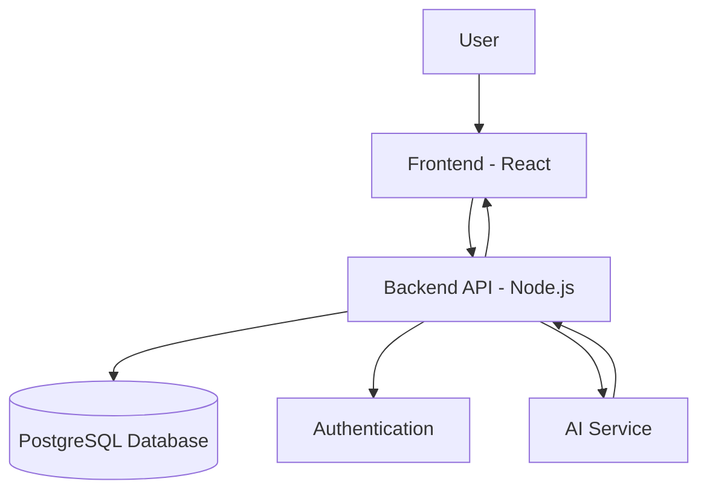

# System Architecture – FocusFlow

## Overview

FocusFlow uses a simple client-server architecture. The frontend communicates with the backend through REST APIs. The backend handles user accounts, tasks, and productivity data, while the AI service provides task suggestions.

## Architecture Diagram

## Main Components

- **Frontend:** React provides the user interface and dashboard.
- **Backend:** Node.js handles requests and application logic.
- **Database:** PostgreSQL stores users, tasks, and categories.
- **Authentication:** Manages user registration and login.
- **AI Service:** Generates task suggestions and helps users prioritize their work.

## Data Flow

Users interact with the frontend, which sends requests to the backend API. The backend processes the requests and communicates with the database or AI service when needed. Results are then returned to the frontend.
